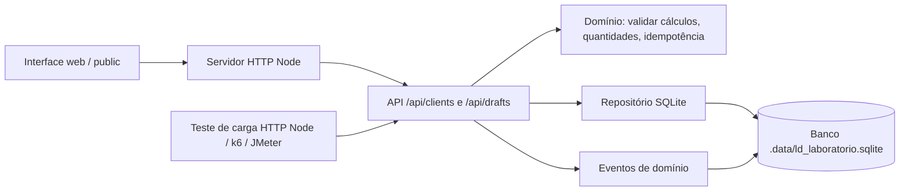

# Arquitetura do laboratório — DDD aplicado ao módulo de qualidade

## Contextos e responsabilidade

- **Clientes**: cadastro de empresas fictícias (sem CPF/CNPJ real).
- **Pré-notas simuladas**: rascunhos para demonstrar cálculo e validação, **não emissor fiscal**.
- **Qualidade**: testes unitários e integração, persistência, comportamento, carga e métricas.

## Regras de consistência

- Transação SQL para cabeçalho, itens e evento do documento.
- Índice único em `(client_id, idempotency_key)`.
- Relação com cliente via FK, bloqueando documento órfão.
- Total em centavos inteiros e cálculo validado.
- Retorno `201` para criação e `200` para repetição idempotente.
- `409` para mesma chave com conteúdo diferente.

## Isolamento

- Servidor HTTP em `127.0.0.1`, não acessível diretamente por outra máquina.
- `.data` fora do Git; testes usam `:memory:` ou arquivos temporários próprios.
- Acesso à API **não é autenticado**; não adicionar credenciais ou dados reais.
- O banco real LD Gestão/Supabase não é usado nem modificado.

## Evolução arquitetural futura

Na aplicação real, usar autenticação e autorização, isolamento por empresa (tenant), auditoria assinada/imutável, PostgreSQL transacional, índices apropriados, limites de requisição, observabilidade e testes de integração com banco separado. A emissão de NFS-e dependerá de provedor fiscal e fluxo jurídico/municipal verificado à parte.
